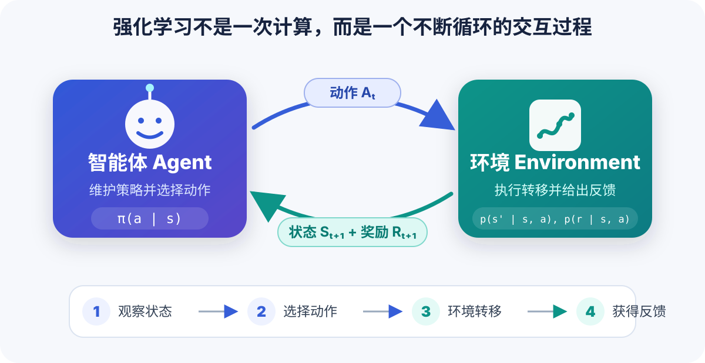
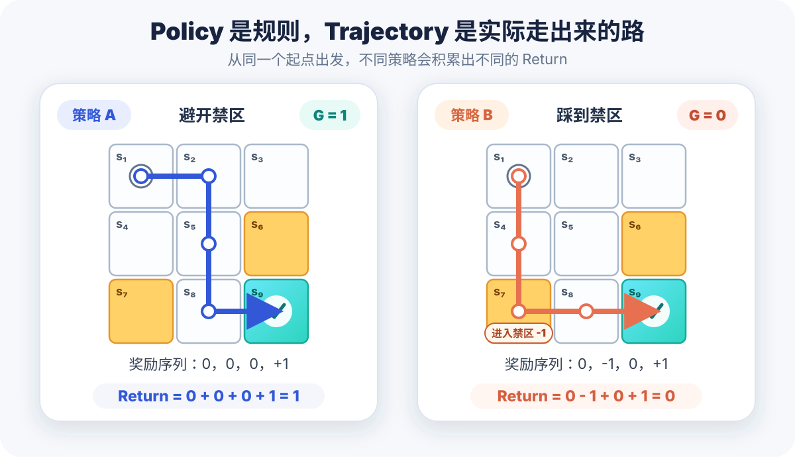
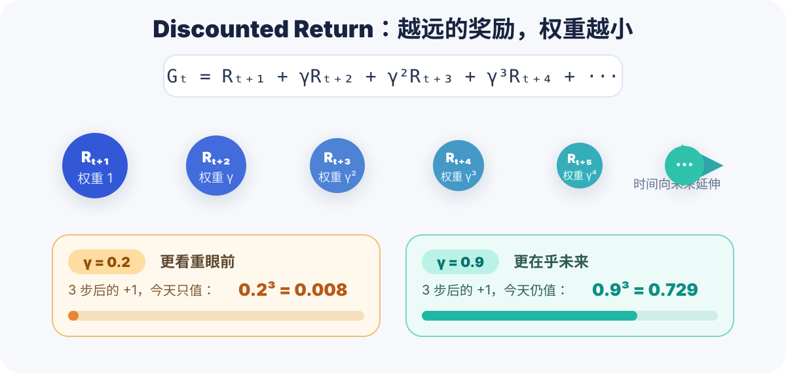

## 前言

这是「从零开始学强化学习」系列的第一篇。

这个系列会跟着赵世钰老师的《强化学习的数学原理》课程和配套教材 *Mathematical Foundations of Reinforcement Learning* 往下学。老师的课程从一个很小的网格世界出发，再一步步走到 Bellman 方程、蒙特卡洛、时序差分、DQN、策略梯度和 Actor-Critic，路线相当适合把强化学习的数学地基补完整。

**本文书写顺序紧跟教材 Chapter 1 和 Lecture 1，建议配合[赵世钰老师的课程主页](https://shiyuzhao.westlake.edu.cn/Teaching.htm)与[教材、课件仓库](https://github.com/MathFoundationRL/Book-Mathematical-Foundation-of-Reinforcement-Learning)食用。**

但是！第一章一口气扔出了 state、action、policy、reward、return、episode、MDP 一大堆名词。如果只是把定义背下来，很容易出现一种「每个单词我都认识，连起来就不知道在干嘛」的奇妙状态。

所以这一篇先不碰任何高深算法，只做一件事：**用一个 3×3 的小游戏，把强化学习最基础的语言说清楚。**

学完本文，你应该能回答下面几个问题：

- 状态和动作分别是什么？
- 环境、策略和状态转移之间是什么关系？
- reward 和 return 为什么不是同一个东西？
- 折扣因子 \(\gamma\) 到底在折扣什么？
- MDP 为什么能把上面这些概念全部装进去？

> 本文配图根据赵世钰老师 Lecture 1 与教材 Chapter 1 的网格世界重新绘制。

## 强化学习到底在学什么

先看强化学习最经典的一张图：



强化学习里有两个主角：

- **智能体（Agent）**：负责做决定，比如机器人、游戏角色，或者一个推荐系统。
- **环境（Environment）**：智能体之外的一切，比如地图、游戏规则和用户反馈。

在第 \(t\) 个时间步，智能体观察到状态 \(S_t\)，根据策略选择动作 \(A_t\)。环境接收动作后，转移到新状态 \(S_{t+1}\)，同时给智能体一个奖励 \(R_{t+1}\)。

然后这个过程继续循环：

\[
S_t \longrightarrow A_t \longrightarrow (R_{t+1}, S_{t+1})
\]

它和监督学习最大的区别在于：环境不会直接告诉你「正确答案是向右走」。它只会在你行动后给一点反馈，甚至这个反馈还可能延迟很多步才出现。

所以强化学习真正想学的是：

> 找到一个策略，让智能体在长期交互中拿到尽可能大的总回报。

注意关键词是**长期**。如果只盯着眼前这一步的奖励，智能体很可能会变成一个相当短视的家伙。

## 从一个 3×3 网格世界开始

下面这个网格世界会贯穿赵老师整本书，我们也用它来贯穿这一篇。


游戏规则很简单：

- 机器人一开始位于左上角 \(s_1\)；
- 黄色格子 \(s_6\) 和 \(s_7\) 是禁区；
- 蓝色格子 \(s_9\) 是目标；
- 机器人每一步可以上、右、下、左，或者原地不动；
- 撞到边界会被弹回原来的格子；
- 禁区**可以进入**，只是会受到惩罚，它不是一堵墙。

我们的目标是让机器人从任意起点出发，都能找到一条「好」的路线到达目标。

什么叫好？

直觉上，它应该避开禁区、少绕路、不要一直撞墙。但计算机不懂这些人类直觉，因此我们得把「位置」「移动」「惩罚」「到达目标」全部写成数学对象。

这就轮到第一批概念登场了。

## State：我现在在哪里

**状态（State）**描述智能体相对于环境所处的情况。

在这个最简单的网格世界里，只要知道机器人在哪个格子，就知道了它的状态：

\[
\mathcal{S} = \{s_1,s_2,\ldots,s_9\}
\]

所有可能状态的集合叫做**状态空间（State Space）**，记作 \(\mathcal{S}\)。

这里的状态只是位置，但真实任务里的状态可以复杂得多：

- 下棋：棋盘上所有棋子的布局；
- 自动驾驶：车辆位置、速度、道路和周围障碍物；
- 游戏 AI：角色血量、装备、地图位置和敌人状态；
- 推荐系统：用户最近的行为、兴趣和当前上下文。

有个很容易忽略的点：状态并不等于「随便挑一些能看到的数据」。一个好的状态应该尽量包含预测未来所需的信息。比如控制一辆车，只知道位置却不知道速度，很多时候就不够用了。

这件事后面会被正式写成 **Markov 性质**。

## Action：我接下来能做什么

**动作（Action）**就是智能体可以作出的选择。

在网格世界中，我们定义五个动作：

\[
\mathcal{A} = \{a_1,a_2,a_3,a_4,a_5\}
\]

其中：

| 动作 | 含义 |
|---|---|
| \(a_1\) | 向上 |
| \(a_2\) | 向右 |
| \(a_3\) | 向下 |
| \(a_4\) | 向左 |
| \(a_5\) | 原地不动 |

所有动作组成**动作空间（Action Space）**。

不同状态当然可以拥有不同的动作空间。比如站在左上角 \(s_1\) 时，也可以直接规定「向上」和「向左」这两个动作不存在。

不过赵老师的例子采用了更一般的设定：每个格子都允许五个动作，只是越界后会留在原地并收到惩罚。也就是对任意状态 \(s_i\)，都有：

\[
\mathcal{A}(s_i)=\mathcal{A}
\]

这个设计很有用，因为它把「不能做」改成了「可以尝试，但环境会告诉你这样做不好」。

## State Transition：做完动作会去哪

智能体在状态 \(s\) 执行动作 \(a\) 后，环境会给出下一个状态 \(s'\)。这个过程叫做**状态转移（State Transition）**。

比如：

\[
s_1 \xrightarrow{a_2} s_2
\]

表示机器人在 \(s_1\) 向右走，会来到 \(s_2\)。

撞墙时：

\[
s_1 \xrightarrow{a_1} s_1
\]

机器人并不会飞出地图，而是仍然留在 \(s_1\)。

从 \(s_5\) 向右走则会进入禁区 \(s_6\)：

\[
s_5 \xrightarrow{a_2} s_6
\]

再次强调，禁区在这个例子里是**可进入但有惩罚**，不是不可达区域。环境规则完全可以换一种定义，但一旦定义好，智能体就得在这套规则里学习。

### 确定性和随机性

上面的例子里，给定状态和动作后，下一个状态完全确定。我们可以写成：

\[
p(s_2\mid s_1,a_2)=1
\]

\[
p(s_i\mid s_1,a_2)=0,\qquad i\neq 2
\]

更一般地，状态转移可以是随机的。假设网格里突然刮起妖风，即使机器人选择向右，也可能被吹到别的格子，那么就会出现：

\[
p(s'\mid s,a)\in[0,1]
\]

并且所有可能下一个状态的概率之和必须为 1：

\[
\sum_{s'\in\mathcal{S}}p(s'\mid s,a)=1
\]

\(p(s'\mid s,a)\) 被称为**状态转移概率**。所有状态转移概率放在一起，就是环境的 **model** 或 **dynamics**。

先记住这句话：**动作由智能体选，下一个状态由环境决定。**

## Policy：在每个状态下怎么选动作

知道「能做什么」还不够，智能体还需要一套做决定的方法，这就是**策略（Policy）**。

策略通常记作：

\[
\pi(a\mid s)
\]

它表示智能体位于状态 \(s\) 时，选择动作 \(a\) 的概率。

如果在 \(s_1\) 时一定向右走，那么：

\[
\pi(a_2\mid s_1)=1
\]

其他动作的概率都是 0。这叫做**确定性策略**。

如果机器人在 \(s_1\) 时有一半概率向右、一半概率向下，那么：

\[
\pi(a_2\mid s_1)=0.5,\qquad
\pi(a_3\mid s_1)=0.5
\]

这叫做**随机策略**。

无论是哪一种，每个状态下所有动作的概率都要加起来等于 1：

\[
\sum_{a\in\mathcal{A}(s)}\pi(a\mid s)=1
\]

这里最容易混淆的是：

- **策略**是一整套规则，回答「每个状态下该怎么选动作」；
- **轨迹**是实际运行一次以后，真正走出来的那条路。

同一个随机策略运行两次，完全可能产生两条不同的轨迹。

## Reward：环境对这一步的评价

智能体每执行一个动作，环境就会返回一个实数作为反馈，这就是**奖励（Reward）**。

在网格世界中，我们这样设计奖励：

| 情况 | 奖励 |
|---|---:|
| 试图越过边界 | \(-1\) |
| 进入禁区 | \(-1\) |
| 到达目标 | \(+1\) |
| 其他情况 | \(0\) |

奖励可以写成 \(r(s,a)\)。如果奖励本身也带随机性，就用条件概率 \(p(r\mid s,a)\) 来描述。

奖励其实是人类和智能体之间的一种接口：我们没告诉它正确路线，但通过奖励表达了「我希望你到达目标，也希望你少撞墙、别踩禁区」。

听起来很简单，但 reward design 往往是强化学习里最难的工作之一。奖励写歪一点，智能体就可能钻规则的空子，用一种你完全没想到的方式拿高分。

还有两个初学者很容易踩的坑。

### 正奖励不一定代表绝对的好

真正影响行为的是奖励之间的**相对大小**。把所有奖励同时加上一个常数，在一些设定下不会改变最优策略。

所以重点并不是某个数字「看起来正不正能量」，而是不同选择最终能积累多少回报。

### 下一个状态相同，奖励也可能不同

在 \(s_1\) 向上撞墙和在 \(s_1\) 原地不动，下一状态都是 \(s_1\)，但前者奖励为 \(-1\)，后者奖励为 \(0\)。

因此，只看 \(s'\) 不一定能推出奖励。教材用 \(r(s,a)\) 来定义奖励；在很多其他资料里，你也会见到 \(r(s,a,s')\)。两种写法可以通过条件概率互相转换，不用看到符号不同就怀疑自己学错了。

## Trajectory 与 Return：别只看眼前这一分

状态、动作和奖励按时间串起来，就得到一条**轨迹（Trajectory）**：

\[
s_0 \xrightarrow{a_0,r_1}
s_1 \xrightarrow{a_1,r_2}
s_2 \xrightarrow{a_2,r_3}\cdots
\]

同一起点下，两种策略可能产生下面两条路线：



策略 A 走：

\[
s_1\rightarrow s_2\rightarrow s_5\rightarrow s_8\rightarrow s_9
\]

得到的奖励为：

\[
0+0+0+1=1
\]

策略 B 会踩到禁区 \(s_7\)：

\[
s_1\rightarrow s_4\rightarrow s_7\rightarrow s_8\rightarrow s_9
\]

得到的奖励为：

\[
0-1+0+1=0
\]

一条轨迹上所有奖励的总和叫做**回报（Return）**，也叫累计奖励。

于是「策略 A 更好」不再只是人类感觉，而有了一个可以比较的数学指标：它获得的 return 更大。

这也解释了为什么不能每一步都贪心地选择 immediate reward 最大的动作。某一步暂时吃亏，可能会换来后面更大的奖励；反过来，眼前拿到一点甜头，也可能把自己送进长期陷阱。

**Reward 是一步的反馈，Return 是一串未来反馈的总账。**

## Discounted Return：未来的一块钱值多少

如果轨迹是无限长的，直接把奖励相加可能会发散。

比如机器人到达 \(s_9\) 后一直原地不动，并且每一步都获得 \(+1\)：

\[
1+1+1+\cdots=\infty
\]

这时候就需要引入折扣因子 \(\gamma\in[0,1)\)，定义**折扣回报（Discounted Return）**：

\[
\begin{aligned}
G_t
&=R_{t+1}+\gamma R_{t+2}\\
&\quad+\gamma^2R_{t+3}+\cdots\\
&=\sum_{k=0}^{\infty}\gamma^kR_{t+k+1}
\end{aligned}
\]



\(\gamma\) 有两个非常直观的作用：

1. 让无限长奖励序列有机会收敛；
2. 控制智能体更在乎眼前还是未来。

当 \(\gamma\) 接近 0 时，智能体非常短视，远处的奖励几乎看不见。

当 \(\gamma\) 接近 1 时，智能体更愿意考虑长远收益，甚至可以接受眼前暂时的负奖励。

比如奖励 \(+1\) 在 3 步以后才出现，那么它在今天眼里的权重是 \(\gamma^3\)。\(\gamma=0.2\) 时只剩 \(0.008\)，而 \(\gamma=0.9\) 时还有 \(0.729\)，差别相当大。

## Episode：一次完整的试验

如果交互到某个终止状态就停止，那么从开始到停止的整条轨迹叫做一个 **episode**，也可以理解成一局游戏或一次试验。

- 有终止状态、每局长度有限的任务叫 **episodic task**；
- 没有终止状态、交互一直进行的任务叫 **continuing task**。

网格世界到达目标后到底要不要停止，其实取决于我们怎样定义任务。

一种做法是把 \(s_9\) 设成**吸收状态（absorbing state）**，进去后永远不再离开；另一种做法是把它当成普通状态，机器人还可以继续行动。

赵老师的课程采用第二种方式，这样所有格子都能按照同一套规则处理，也顺手引出了无限轨迹和 discounted return。

## MDP：把所有零件装进同一个框架

现在我们已经有：

- 状态空间 \(\mathcal{S}\)；
- 每个状态下的动作空间 \(\mathcal{A}(s)\)；
- 状态转移概率 \(p(s'\mid s,a)\)；
- 奖励概率 \(p(r\mid s,a)\)；
- 策略 \(\pi(a\mid s)\)；
- 回报与折扣因子 \(\gamma\)。

这些东西组合起来，就得到了强化学习里最核心的建模框架：**Markov Decision Process，马尔可夫决策过程，简称 MDP**。

### Markov 性质

MDP 中的 M 指的是 Markov，也就是常说的「无记忆性」：

把当前时刻之前的全部历史记作 \(H_t=(s_{t-1},a_{t-1},\ldots,s_0,a_0)\)，那么：

\[
\begin{aligned}
p(s_{t+1}\mid s_t,a_t,H_t)
&=p(s_{t+1}\mid s_t,a_t),\\
p(r_{t+1}\mid s_t,a_t,H_t)
&=p(r_{t+1}\mid s_t,a_t).
\end{aligned}
\]

人话就是：

> 只要当前状态 \(s_t\) 已经描述得足够完整，那么预测下一状态和奖励时，不需要再把整个历史重新翻一遍。

它并不是说世界真的没有历史，而是说**历史里对未来有用的信息，应该已经被压进当前状态了**。

比如一辆正在行驶的车，如果状态只有「当前位置」，通常就不满足 Markov 性质；把速度、方向等信息也放进状态后，才更有可能根据当前状态预测下一刻。

### MDP 和 Markov Process 的区别

MDP 里还有动作选择，智能体可以通过策略影响未来。

一旦策略 \(\pi\) 被固定，在每个状态下该采取动作的概率也固定了，MDP 就退化成了一个 Markov Process；如果时间和状态都是离散的，也常叫 Markov Chain。

所以你可以这样记：

> MDP = 能做决策的 Markov Process。

## 用 Python 把这几个概念跑起来

概念差不多了，下面用不到 70 行 Python，把这个网格世界真正跑一下。

```python
ACTIONS = {
    "up": (-1, 0),
    "right": (0, 1),
    "down": (1, 0),
    "left": (0, -1),
    "stay": (0, 0),
}

FORBIDDEN = {6, 7}
TARGET = 9


def step(state: int, action: str) -> tuple[int, int]:
    """执行一个动作，返回 (next_state, reward)。"""
    row, col = divmod(state - 1, 3)
    d_row, d_col = ACTIONS[action]
    next_row, next_col = row + d_row, col + d_col

    # 越界：留在原地并获得 -1
    if not (0 <= next_row < 3 and 0 <= next_col < 3):
        return state, -1

    next_state = next_row * 3 + next_col + 1

    # 这个环境是确定性的，因此可以在 step 中直接根据结果计算 r(s, a)
    if next_state in FORBIDDEN:
        reward = -1
    elif next_state == TARGET:
        reward = 1
    else:
        reward = 0

    return next_state, reward


def rollout(start: int, policy: dict[int, str], gamma: float = 0.9):
    """按给定策略生成一条 episode。"""
    state = start
    states = [state]
    rewards = []
    discounted_return = 0.0

    for t in range(20):
        action = policy[state]
        state, reward = step(state, action)

        states.append(state)
        rewards.append(reward)
        discounted_return += (gamma**t) * reward

        if state == TARGET:
            break

    return states, rewards, discounted_return


good_policy = {
    1: "right", 2: "down", 5: "down", 8: "right"
}

bad_policy = {
    1: "down", 4: "down", 7: "right", 8: "right"
}

for name, policy in [("good", good_policy), ("bad", bad_policy)]:
    states, rewards, g = rollout(1, policy)
    print(f"{name:>4}: states={states}, rewards={rewards}, G={g:.3f}")
```

运行结果：

```text
good: states=[1, 2, 5, 8, 9], rewards=[0, 0, 0, 1], G=0.729
 bad: states=[1, 4, 7, 8, 9], rewards=[0, -1, 0, 1], G=-0.171
```

这段代码虽然简单，但里面已经出现了一个完整 MDP 的雏形：

- `state` 是机器人所在格子；
- `action` 是五种移动方式；
- `step` 定义环境的状态转移和奖励；
- `policy` 定义每个状态下选择什么动作；
- `rollout` 生成轨迹和 episode；
- `discounted_return` 用来评价策略。

不过注意，我们现在是**手写**了 good policy 和 bad policy，还没有让智能体自己学会策略。

真正的强化学习算法，就是接下来要解决这件事。

## 总结

这一篇看起来名词很多，但它们其实都在回答同一条交互链上的不同问题：

| 概念 | 它回答的问题 |
|---|---|
| State | 我现在处于什么情况？ |
| Action | 我能做什么？ |
| State transition | 做完以后环境会变成什么样？ |
| Policy | 我应该怎样选动作？ |
| Reward | 环境怎样评价这一步？ |
| Trajectory | 这一次实际经历了什么？ |
| Return | 这一串经历总共赚了多少？ |
| Episode | 一次完整试验从哪里开始、在哪里结束？ |
| MDP | 怎样用统一的数学框架描述以上全部内容？ |

到这里，我们还没有学任何「让机器人自动变聪明」的算法，只是把问题定义清楚了。

但这一步相当重要。后面不管是 Value Iteration、Q-learning、DQN 还是 PPO，说到底都在这套语言里工作。

下一篇我们会进入整本书真正的地基：**Bellman Equation**。也就是把「长期回报」拆成「眼前一步 + 剩下的未来」，看看一个看似无限的问题，为什么可以被递归地算出来。

总之，强化学习的大门已经打开了。现在这个机器人还只会按我们写好的策略走，下一篇开始，就该想办法让它自己学了 hhh。
