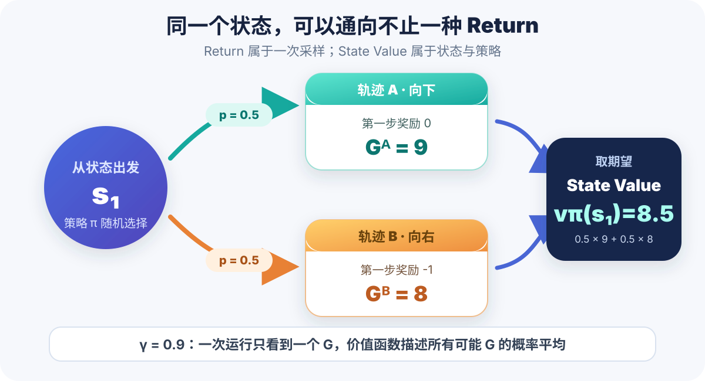
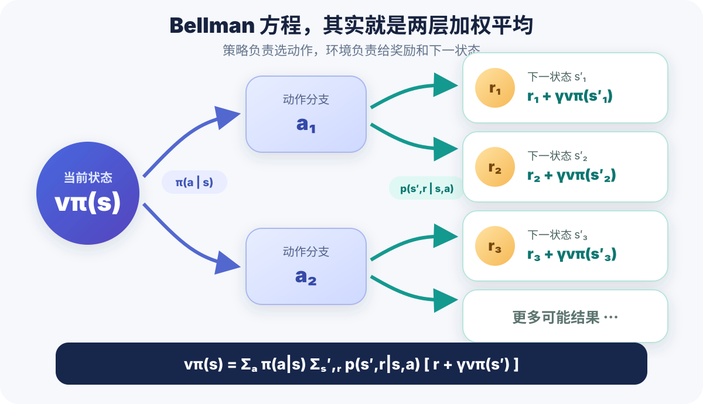
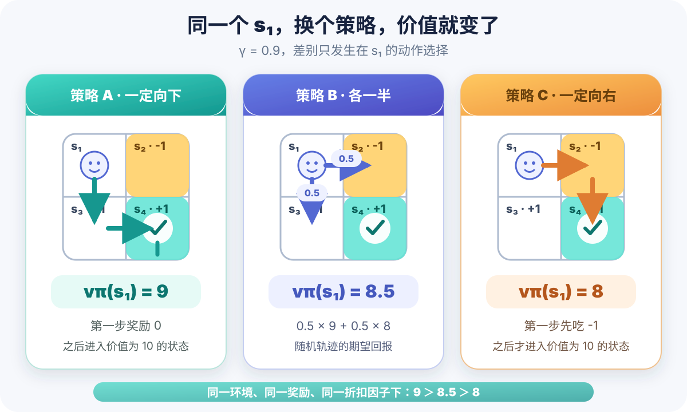
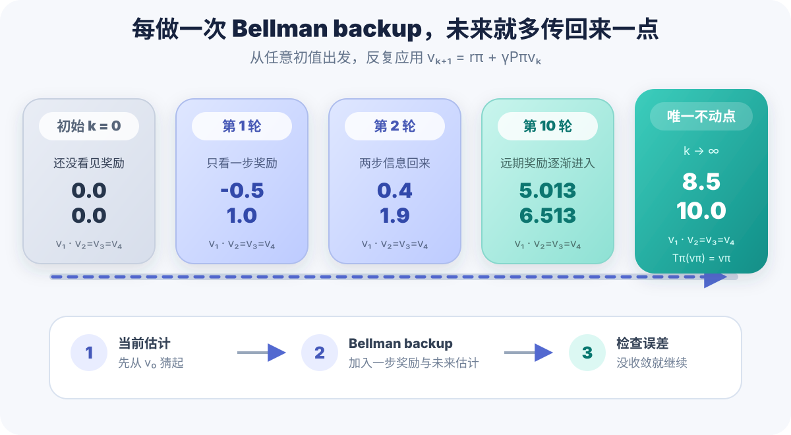
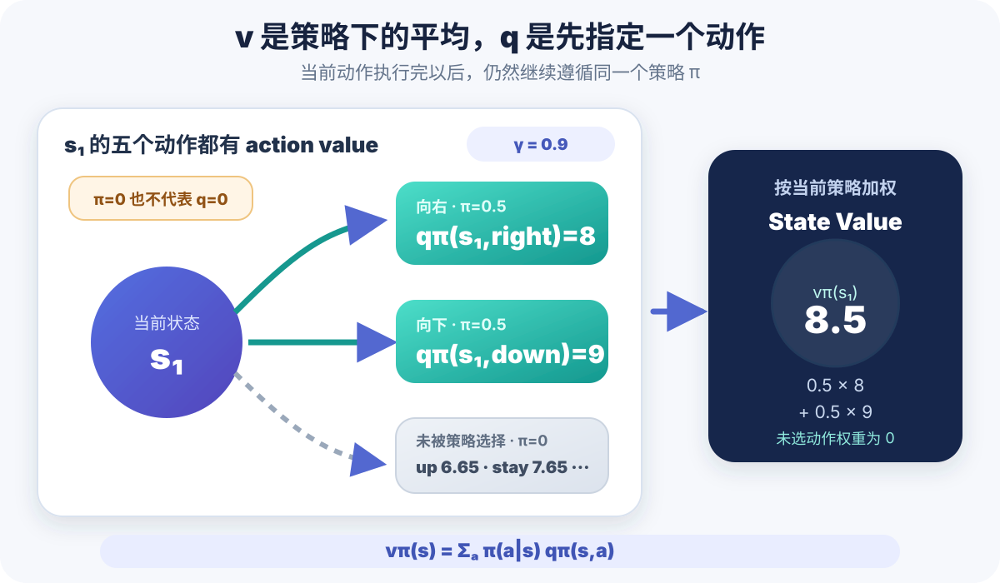

## 前言

这是「从零开始学强化学习」系列的第二篇。

上一篇我们把 state、action、policy、reward、return 和 MDP 这些基本概念捋了一遍，也留下了一个非常现实的问题：**知道长期回报很重要，然后呢？难道每次评价策略，都要真的跑到世界尽头，再把所有奖励加起来吗？**

显然不太行。轨迹可能是随机的，也可能长到没有尽头。真等它跑完，黄花菜都凉了（甚至它根本不会跑完）。

这一篇继续跟着赵世钰老师的 Lecture 2 和教材 Chapter 2，认识整本书真正的数学地基：**状态价值（State Value）与 Bellman 方程（Bellman Equation）**。

**本文书写顺序紧跟教材 Chapter 2 和 Lecture 2，建议配合[赵世钰老师的课程主页](https://shiyuzhao.westlake.edu.cn/Teaching.htm)与[教材、课件仓库](https://github.com/MathFoundationRL/Book-Mathematical-Foundation-of-Reinforcement-Learning)食用。**

学完本文，你应该能回答下面几个问题：

- 一条轨迹的 return，为什么还不能直接代表一个状态的价值？
- $v_\pi(s)$ 里的 $\pi$ 为什么绝对不能省略？
- Bellman 方程为什么能把「无限未来」拆成「眼前一步 + 剩下的未来」？
- 一个未知量依赖另一个未知量，为什么不是死循环？
- 什么是 policy evaluation，它和寻找最优策略有什么区别？
- $v_\pi(s)$ 与 $q_\pi(s,a)$ 到底是什么关系？

> 本文配图根据赵世钰老师 Lecture 2 与教材 Chapter 2 的四状态示例重新绘制，代码与数值均独立计算验证。

## 先把目标说清楚：这一章是在评价策略

先别急着上公式，我们先确定这一章到底要解决什么问题。

假设策略 $\pi$ 已经给定：在每个状态下，各个动作被选择的概率都已经确定。环境模型也已知：做完动作后会去哪里、拿到什么奖励，以及各自的概率都知道。

现在的问题是：

> 从状态 $s$ 出发，一直按照策略 $\pi$ 行动，长期来看能拿到多少回报？

求出所有状态的答案，就叫做**策略评估（Policy Evaluation）**。

注意，这里暂时不是让智能体找最优策略，而是给现有策略做一次「体检」。先会判断一个策略到底好不好，后面才谈得上把它改得更好。

## Return 只属于一条轨迹

上一篇定义了折扣回报：

\[
G_t=R_{t+1}+\gamma R_{t+2}+\gamma^2R_{t+3}+\cdots
\]

如果策略和环境都是确定性的，那么从同一个状态出发，每次都会走出同一条轨迹，得到同一个 return。这时，用 return 评价状态完全没问题。

但只要策略或环境带一点随机性，事情就变了。



还是教材里的 $2\times2$ 小世界。机器人从 $s_1$ 出发：

- 有 $0.5$ 的概率向下走，第一步奖励为 $0$，之后每步都拿 $+1$；
- 有 $0.5$ 的概率向右走进禁区，第一步奖励为 $-1$，之后同样每步拿 $+1$。

两条轨迹的 return 分别是：

\[
\begin{aligned}
G^{\text{down}}
&=0+\gamma+\gamma^2+\cdots\\
&=\frac{\gamma}{1-\gamma}
\end{aligned}
\]

\[
\begin{aligned}
G^{\text{right}}
&=-1+\gamma+\gamma^2+\cdots\\
&=-1+\frac{\gamma}{1-\gamma}
\end{aligned}
\]

当 $\gamma=0.9$ 时，它们分别等于 $9$ 和 $8$。

所以「从 $s_1$ 出发的 return 是多少」已经没有唯一答案了。一次采样拿到 $9$，另一次可能拿到 $8$。**Return 描述的是一条实际轨迹的结果，而不是这个状态在长期意义上的稳定评价。**

## State Value：把所有可能未来取平均

既然同一个状态会通向很多条轨迹，那就把这些轨迹的 return 按概率取期望：

\[
\boxed{
v_\pi(s)=\mathbb{E}_\pi[G_t\mid S_t=s]
}
\]

这就是策略 $\pi$ 下的**状态价值函数（State-Value Function）**，通常也简称状态价值。

上面随机策略的例子中：

\[
\begin{aligned}
v_\pi(s_1)
&=0.5G^{\text{down}}+0.5G^{\text{right}}\\
&=0.5\times9+0.5\times8\\
&=8.5.
\end{aligned}
\]

这时，三个很容易被忽略的细节来了。

### 它依赖状态 $s$

公式里的条件 $S_t=s$ 表示「从哪个状态出发」。起点不同，未来能拿到的回报当然可能不同。

### 它更依赖策略 $\pi$

同一个状态，换一套动作选择规则，后面的轨迹分布就变了，价值自然也会变。

所以 $v_\pi(s)$ 里的下标 $\pi$ 不是装饰品。只写「$s_1$ 的价值是 8.5」并不完整，必须说清楚：**在策略 $\pi$ 下，$s_1$ 的价值是 8.5。**

### 它不依赖具体时刻 $t$

在平稳的 MDP 中，只要当前状态仍然是 $s$，后面的策略和环境规则没有随时间改变，那么状态价值就不会因为「现在是第 3 步还是第 300 步」而改变。

一句话总结：

> Return 是一次实际经历的总账；State Value 是从某个状态出发、遵循某个策略时，所有可能总账的期望。

## 最关键的一刀：把 Return 拆成两段

现在终于轮到 Bellman 方程登场了。

先看折扣回报：

\[
G_t=R_{t+1}+\gamma R_{t+2}+\gamma^2R_{t+3}+\cdots
\]

把第一项单独拿出来，剩下部分提取一个 $\gamma$：

\[
\begin{aligned}
G_t
&=R_{t+1}+\gamma(R_{t+2}+\gamma R_{t+3}+\cdots)\\
&=R_{t+1}+\gamma G_{t+1}.
\end{aligned}
\]

就是这么朴素的一步，却是后面几乎所有 value-based 方法的起点：

\[
\boxed{G_t=R_{t+1}+\gamma G_{t+1}}
\]

人话翻译一下：

> 从现在开始的全部回报 = 下一步立刻拿到的奖励 + 折扣后的剩余全部回报。

一个看起来无限长的序列，被切成了「一步」和「同一种问题的下一时刻版本」。这种用后续估计更新当前估计的思路，叫做 **bootstrapping（自举）**。

注意这里的自举不是凭空猜答案，而是利用问题自身的递归结构。

## Bellman 方程：眼前一步 + 折扣后的未来

对刚才的递推式，在 $S_t=s$ 的条件下取期望：

\[
\begin{aligned}
v_\pi(s)
&=\mathbb{E}_\pi[G_t\mid S_t=s]\\
&=\mathbb{E}_\pi[R_{t+1}+\gamma G_{t+1}\mid S_t=s].
\end{aligned}
\]

利用期望的线性性质，以及 Markov 性质带来的「到达 $S_{t+1}$ 后，不必再翻旧账」，就得到最直观的形式：

\[
\boxed{
\begin{aligned}
v_\pi(s)
&=\mathbb{E}_\pi\big[
R_{t+1}+\gamma v_\pi(S_{t+1})\\
&\qquad\mid S_t=s
\big]
\end{aligned}
}
\]



这就是 **Bellman 方程**。在很多资料里，为了和后面的 Bellman optimality equation 区分，它也会被叫做 **Bellman expectation equation**。

它只有两部分：

1. **即时奖励** $R_{t+1}$：这一步马上得到什么；
2. **未来价值** $\gamma v_\pi(S_{t+1})$：下一状态之后还能得到什么。

如果把动作、奖励和下一状态的全部概率展开，教材中的形式是：

\[
\boxed{
\begin{aligned}
v_\pi(s)
&=\sum_a\pi(a\mid s)\Bigg[
\sum_r p(r\mid s,a)r\\
&\qquad+\gamma\sum_{s'}p(s'\mid s,a)v_\pi(s')
\Bigg],\\
&\hspace{7em}\forall s\in\mathcal S
\end{aligned}
}
\]

从外向内读就不吓人了：

1. 策略用 $\pi(a\mid s)$ 对「选哪个动作」取平均；
2. 环境用 $p(r\mid s,a)$ 对「立即拿多少奖励」取平均；
3. 环境再用 $p(s^{\prime}\mid s,a)$ 对「会到哪个下一状态」取平均；
4. 下一状态的价值乘上折扣因子 $\gamma$。

如果奖励与下一状态需要联合描述，也经常写成更紧凑的形式：

\[
\begin{aligned}
v_\pi(s)
&=\sum_a\sum_{s',r}
\pi(a\mid s)p(s',r\mid s,a)\\
&\qquad\cdot\left[r+\gamma v_\pi(s')\right].
\end{aligned}
\]

符号长得不一样，但核心还是那八个字：**即时奖励，加上未来价值。**

## 它不是死循环，而是一组联立方程

初看 Bellman 方程，最容易冒出来的疑问是：

> 我就是不知道 $v_\pi(s)$ 才来算它，结果右边又出现了另一个未知的 $v_\pi(s^{\prime})$，这不是循环依赖吗？

关键在公式最后的 $\forall s\in\mathcal S$：**Bellman 方程不是某一个状态的一条孤立公式，而是每个状态各有一条方程。**

把所有状态的方程放在一起，它就是一个普通的线性方程组。

### 四状态例子

继续使用教材中的 $2\times2$ 世界：

- $s_1\rightarrow s_3$：向下，奖励 $0$；
- $s_1\rightarrow s_2$：向右进入禁区，奖励 $-1$；
- $s_2\rightarrow s_4$ 与 $s_3\rightarrow s_4$：奖励 $+1$；
- 在 $s_4$ 原地不动：每一步奖励 $+1$。



先看确定性向下的策略。四个状态的 Bellman 方程为：

\[
\begin{aligned}
v_\pi(s_1)&=0+\gamma v_\pi(s_3),\\
v_\pi(s_2)&=1+\gamma v_\pi(s_4),\\
v_\pi(s_3)&=1+\gamma v_\pi(s_4),\\
v_\pi(s_4)&=1+\gamma v_\pi(s_4).
\end{aligned}
\]

最后一条虽然左右都有 $v_\pi(s_4)$，但移项就能解：

\[
v_\pi(s_4)=\frac{1}{1-\gamma}.
\]

当 $\gamma=0.9$ 时：

\[
\begin{aligned}
v_\pi(s_4)=v_\pi(s_3)=v_\pi(s_2)&=10,\\
v_\pi(s_1)&=9.
\end{aligned}
\]

如果 $s_1$ 以 $0.5$ 概率向右、$0.5$ 概率向下，那么只有第一条变成：

\[
\begin{aligned}
v_\pi(s_1)
&=0.5[-1+\gamma v_\pi(s_2)]\\
&\qquad+0.5[0+\gamma v_\pi(s_3)].
\end{aligned}
\]

代入 $v_\pi(s_2)=v_\pi(s_3)=10$，得到：

\[
v_\pi(s_1)=0.5\times8+0.5\times9=8.5.
\]

这和前面直接对两种 return 取期望的结果完全一致。只不过 Bellman 方程没有把无限长轨迹从头展开，而是借用了下一状态已经压缩好的价值。

## 矩阵形式：把所有状态一次装进去

当状态多起来，一条条手写方程会非常痛苦。于是把它们打包成矩阵：

\[
\boxed{
\mathbf v_\pi=\mathbf r_\pi+\gamma\mathbf P_\pi\mathbf v_\pi
}
\]

其中：

- $\mathbf v_\pi$ 是所有状态价值组成的列向量；
- $\mathbf r_\pi$ 是策略 $\pi$ 下，每个状态的期望即时奖励；
- $\mathbf P_\pi$ 是策略 $\pi$ 下的状态转移矩阵；
- $\mathbf P_\pi$ 每一行的元素之和为 $1$。

对于上面的随机策略：

\[
\mathbf r_\pi=
\begin{bmatrix}
-0.5\\1\\1\\1
\end{bmatrix}.
\]

\[
\mathbf P_\pi=
\begin{bmatrix}
0&0.5&0.5&0\\
0&0&0&1\\
0&0&0&1\\
0&0&0&1
\end{bmatrix}.
\]

第一行的 $(0.5,0.5)$ 表示从 $s_1$ 出发，有一半概率到 $s_2$，一半概率到 $s_3$。后三行则是确定性转移。

移项可以得到闭式解：

\[
(\mathbf I-\gamma\mathbf P_\pi)\mathbf v_\pi
=\mathbf r_\pi
\]

\[
\boxed{
\mathbf v_\pi
=(\mathbf I-\gamma\mathbf P_\pi)^{-1}\mathbf r_\pi
}
\]

数学上非常漂亮。但工程上，显式求逆通常不是一个好主意：状态一多，矩阵会大得离谱；而且后面很多任务里，我们连完整的 $\mathbf P_\pi$ 都拿不到。

所以，更重要的是下一种解法。

## 迭代策略评估：先猜一个，再反复 Bellman backup

定义 Bellman operator：

\[
\mathcal T_\pi(\mathbf v)
=\mathbf r_\pi+\gamma\mathbf P_\pi\mathbf v.
\]

真正的状态价值就是它的不动点：

\[
\mathbf v_\pi=\mathcal T_\pi(\mathbf v_\pi).
\]

于是我们可以从任意初值 $\mathbf v_0$ 出发，反复更新：

\[
\boxed{
\mathbf v_{k+1}
=\mathbf r_\pi+\gamma\mathbf P_\pi\mathbf v_k
}
\]



在四状态例子里，从 $\mathbf v_0=\mathbf 0$ 开始：

\[
\begin{aligned}
\mathbf v_1&=[-0.5,1,1,1]^\mathsf T,\\
\mathbf v_2&=[0.4,1.9,1.9,1.9]^\mathsf T,\\
\mathbf v_3&=[1.21,2.71,2.71,2.71]^\mathsf T,\\
&\ \vdots\\
\mathbf v_k&\longrightarrow[8.5,10,10,10]^\mathsf T.
\end{aligned}
\]

这个过程也很好理解：

- 第 1 轮只看见一步奖励；
- 第 2 轮把两步之内的信息传回来；
- 第 3 轮又把更远一步的奖励传回来；
- 不断迭代后，越来越远的未来被逐渐折叠进当前价值。

为什么它会收敛？因为 $0\le\gamma<1$，Bellman operator 会把两个价值估计之间的最大差距至少缩小为原来的 $\gamma$ 倍：

\[
\lVert\mathcal T_\pi(\mathbf u)-\mathcal T_\pi(\mathbf v)\rVert_\infty
\le\gamma\lVert\mathbf u-\mathbf v\rVert_\infty.
\]

这叫做**压缩映射（Contraction Mapping）**。你可以把它想成一根不断回弹的橡皮筋：每更新一次，估计值就被拉向唯一的不动点，不会永远在外面乱飘。

## 用 Python 真正算一次

下面不用 NumPy，直接把 Bellman backup 写出来。`MODEL[state]` 中的每一项都是：

```text
(发生概率, 即时奖励, 下一状态)
```

完整代码如下：

```python
GAMMA = 0.9

# s1: 0.5 概率向右进入 s2，0.5 概率向下进入 s3
# s2、s3: 确定性进入 s4；s4: 原地不动
MODEL = {
    1: [(0.5, -1, 2), (0.5, 0, 3)],
    2: [(1.0, 1, 4)],
    3: [(1.0, 1, 4)],
    4: [(1.0, 1, 4)],
}


def bellman_backup(state: int, values: dict[int, float]) -> float:
    """用旧的 values 计算状态 state 的一次 Bellman 更新。"""
    return sum(
        probability * (reward + GAMMA * values[next_state])
        for probability, reward, next_state in MODEL[state]
    )


def evaluate_policy(tolerance: float = 1e-10):
    values = {state: 0.0 for state in MODEL}
    print(f"sweep  0: {[round(values[s], 6) for s in MODEL]}")

    for sweep in range(1, 10_000):
        # 同步更新：这一轮的每个新值都只读取上一轮 values
        new_values = {
            state: bellman_backup(state, values)
            for state in MODEL
        }

        delta = max(
            abs(new_values[state] - values[state])
            for state in MODEL
        )
        values = new_values

        if sweep in {1, 2, 3, 10}:
            print(
                f"sweep {sweep:>2}: "
                f"{[round(values[s], 6) for s in MODEL]}"
            )

        if delta < tolerance:
            return values, sweep

    raise RuntimeError("policy evaluation did not converge")


values, sweeps = evaluate_policy()
print(f"converged after {sweeps} sweeps")
print({state: round(value, 6) for state, value in values.items()})
```

运行结果：

```text
sweep  0: [0.0, 0.0, 0.0, 0.0]
sweep  1: [-0.5, 1.0, 1.0, 1.0]
sweep  2: [0.4, 1.9, 1.9, 1.9]
sweep  3: [1.21, 2.71, 2.71, 2.71]
sweep 10: [5.013216, 6.513216, 6.513216, 6.513216]
converged after 220 sweeps
{1: 8.5, 2: 10.0, 3: 10.0, 4: 10.0}
```

这里故意使用了**同步更新**：先根据旧的 `values` 算完所有 `new_values`，再整体替换。这样代码和

\[
\mathbf v_{k+1}=\mathbf r_\pi+\gamma\mathbf P_\pi\mathbf v_k
\]

完全一致。如果在同一轮里一边计算一边覆盖，后面的状态会读到本轮刚更新的值，那会变成另一种同样可能收敛、但顺序相关的更新方式。初学时最好先把两者分清楚。

另外，220 轮并不代表这个四状态问题真的很难。我们把误差阈值设成了相当严格的 $10^{-10}$，而且 $\gamma=0.9$ 会让尾部慢慢逼近。只保留三位小数时，远远不需要这么多轮。

## Action Value：不只问「这个状态怎样」，还要问「这个动作怎样」

状态价值回答的是：

> 从状态 $s$ 出发，之后一直按照策略 $\pi$ 行动，平均能拿多少回报？

但真正做决策时，我们更想知道：

> 在状态 $s$ **先指定执行动作 $a$**，然后再按照策略 $\pi$ 行动，平均能拿多少回报？

这就是**动作价值（Action Value）**：

\[
\boxed{
q_\pi(s,a)
=\mathbb E_\pi[G_t\mid S_t=s,A_t=a]
}
\]

它的 Bellman 形式是：

\[
\boxed{
\begin{aligned}
q_\pi(s,a)
&=\sum_{s',r}p(s',r\mid s,a)\\
&\qquad\cdot\left[r+\gamma v_\pi(s')\right]
\end{aligned}
}
\]

注意，$q_\pi(s,a)$ 只是把**当前这一步**的动作钉死为 $a$。从下一状态开始，仍然继续遵循原策略 $\pi$。



在上面的 $s_1$ 中：

\[
q_\pi(s_1,\text{right})=-1+0.9\times10=8,
\]

\[
q_\pi(s_1,\text{down})=0+0.9\times10=9.
\]

而随机策略各用 $0.5$ 概率选择它们，所以：

\[
\boxed{
\begin{aligned}
v_\pi(s_1)
&=\sum_a\pi(a\mid s_1)q_\pi(s_1,a)\\
&=0.5\times8+0.5\times9\\
&=8.5
\end{aligned}
}
\]

于是 $v$ 和 $q$ 的关系非常清楚：

- $q_\pi(s,a)$：先固定当前动作，再看后面的长期回报；
- $v_\pi(s)$：不固定当前动作，按照策略概率对所有动作价值取平均。

### 没被当前策略选中的动作，也有价值

这是教材专门提醒的一个易错点。

假设当前策略在 $s_1$ 只会向右或向下，那么向上、向左、原地不动的概率都是 0。它们的 action value 会不会也等于 0？

**不会。**

策略不选择某个动作，只说明 $\pi(a\mid s_1)=0$，不代表执行这个动作以后没有回报。比如向上撞墙，得到 $-1$ 并回到 $s_1$，那么：

\[
\begin{aligned}
q_\pi(s_1,\text{up})
&=-1+\gamma v_\pi(s_1)\\
&=-1+0.9\times8.5\\
&=6.65.
\end{aligned}
\]

它不是 0，只是没有被当前策略采用。

这件事相当重要：当前策略可能本来就不够好。如果把所有未选动作都武断地设成 0，就永远没有机会发现被漏掉的好动作。

## 三个最容易混淆的地方

### Bellman 方程不是某一种具体算法

Bellman 方程首先是价值之间必须满足的**关系**。

- 直接解线性方程组，是一种求解方法；
- 反复 Bellman backup，是另一种求解方法；
- 后面的 Monte Carlo、TD、DQN，则是在不同信息条件下估计或逼近这个关系。

不要把「方程」和「解方程的算法」混成一个东西。

### 这一篇没有在取最大值

本文一直在评价一个**给定策略**，所以动作要按照 $\pi(a\mid s)$ 加权平均：

\[
v_\pi(s)=\sum_a\pi(a\mid s)q_\pi(s,a).
\]

如果你在别的资料里看到：

\[
v_*(s)=\max_a q_*(s,a),
\]

那已经是下一章的 **Bellman Optimality Equation** 了。一个是在问「这套策略有多好」，另一个是在问「能做到的最好结果是多少」，别看到都姓 Bellman 就当成同一条公式。

### Value 高低必须放在同一奖励与折扣设定下比较

状态价值完全由奖励定义、折扣因子、环境模型和策略共同决定。

把 reward 或 $\gamma$ 换掉，数值尺度也会变。因此不能拿两个不同任务里的 value 生硬比较，更不能把 value 当成脱离任务设定的某种「绝对幸福指数」。

## 总结

这一篇的公式不少，但真正的主线只有一条：

\[
\boxed{
G_t=R_{t+1}+\gamma G_{t+1}
}
\]

从这条递推关系出发，我们得到：

| 概念 | 它回答的问题 |
|---|---|
| Return $G_t$ | 这一条实际轨迹最终赚了多少？ |
| State value $v_\pi(s)$ | 从状态 $s$ 出发并遵循 $\pi$，平均能赚多少？ |
| Bellman equation | 当前价值怎样由一步奖励和下一状态价值组成？ |
| Bootstrapping | 怎样用后续估计来更新当前估计？ |
| Policy evaluation | 怎样求出给定策略的所有状态价值？ |
| Action value $q_\pi(s,a)$ | 在 $s$ 先做 $a$，之后遵循 $\pi$，平均能赚多少？ |

最值得记住的三个公式是：

\[
v_\pi(s)=\mathbb E_\pi[G_t\mid S_t=s],
\]

\[
v_\pi(s)=\mathbb E_\pi[R_{t+1}+\gamma v_\pi(S_{t+1})\mid S_t=s],
\]

\[
v_\pi(s)=\sum_a\pi(a\mid s)q_\pi(s,a).
\]

到这里，我们已经能评价一个给定策略，但还不会回答「所有可能策略里，哪个才是最好的」。

下一篇就进入 **Bellman Optimality Equation**：把「按照当前策略取平均」换成「从动作中选最大值」，正式定义最优状态价值和最优动作价值。

这一次，机器人终于不只是在接受体检，而是准备开始琢磨怎么把分数考高了 hhh。
