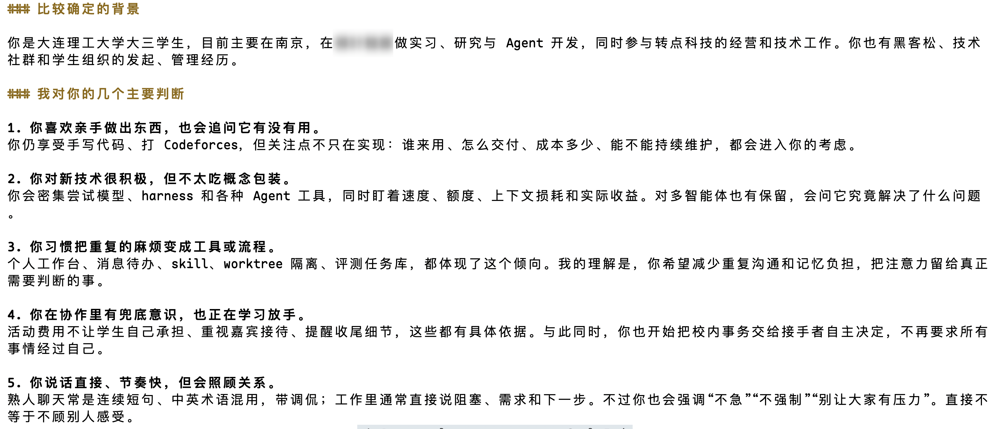
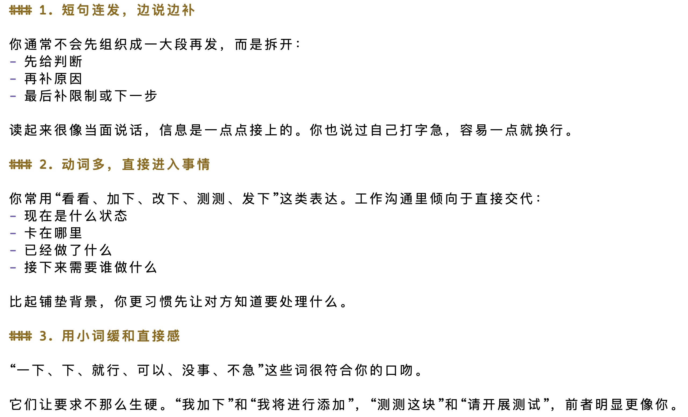
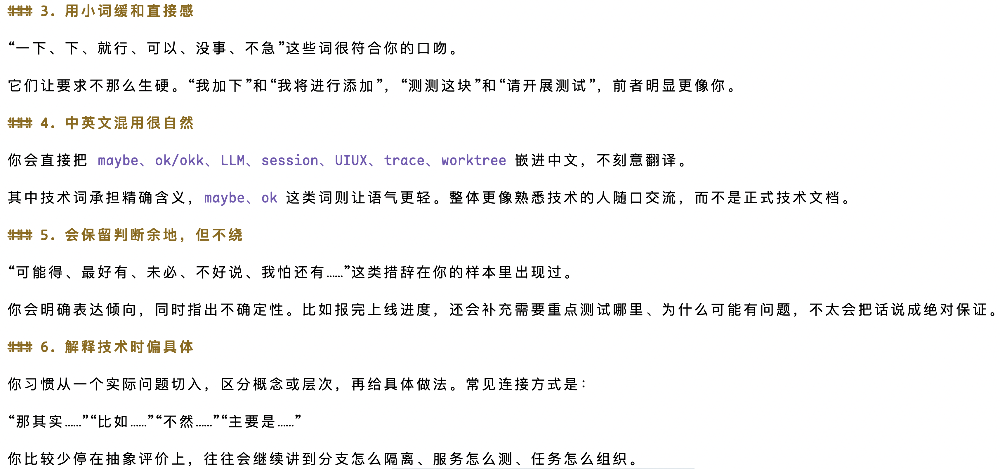
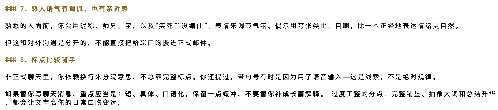
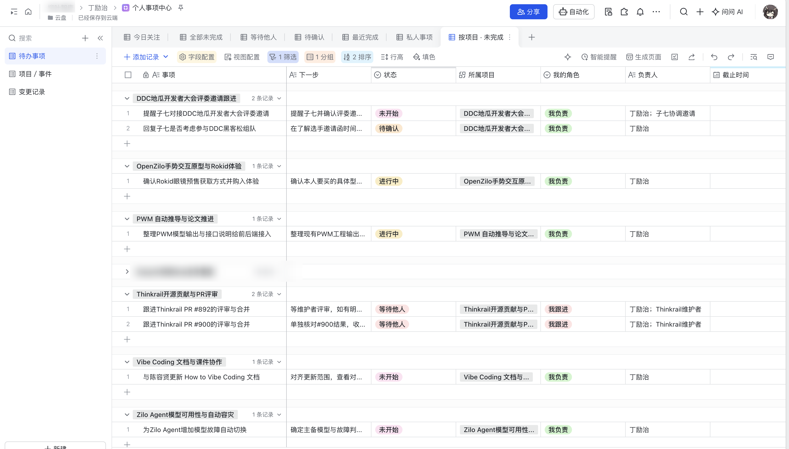

## background

由于最近事情实在太多，四五个事情同时在推，我也在思考怎么让自己可以更好的并行处理任务，大概整理了一下，难点可能有以下几点：

- 事情过于分散，容易遗漏，上下文不容易集中使用，事情的优先级难以确定
- 顶级模型的token绝对不是无限量的（指gpt astra和claude opus/fable）
- 人的精力是有限的，无法频繁在多个上下文里切换

接下来的文章将根据上述问题来讨论有没有解法

## 集中式的个人上下文管理中心

### 中心化上下文

个人的上下文其实是很多元的，比如来自github、微信、飞书、企业内的自建gitlab、和ai的聊天记录（包括对话和coding记录），为了解决这个困境，我开发了一个skill，在每天早上自动进行全部数据源的汇总，由此，

1. 可以得到我个人的画像（据此可以解决很多个人性的问题）
2. 可以在不同的信息源里，把一个人的几个账号关联到一起，建立起对一个人的全面画像
3. 可以得到我的语气和写作习惯（据此可以解决ai味过重的问题）

我本来以为信息量巨大，所得的内容质量会比较差，但到底还是低估了现在ai的智能程度，长期使用后，得到的结果超过了我的想象，具体效果可以参考下图：

这里还有个好玩的讨论，有了这些东西，再加上微信发送的接口，似乎可以直接让bot代替我回复很多消息，我大哥嘲笑我说我主动物化自己🤣

但确实，在这个啥事都是ai办的时代，和朋友们的交流，或者说和人类们的交流，是让我感到我还活着的很重要的方式。

所以，**短期内**，微信上和大家沟通的一定还是我本人。

### 统一的代办管理中心

通过刚刚描述的信息收集方式，可以产生一个副作用，可以很轻松的提取出，我在每个地方的代办、相关的上下文、ddl、优先级。

据此，可以形成一个统一的代办管理中心。

我尝试通过飞书的多维表格来构建，这样就不需要自己维护一个ui，同时可以很轻松的和飞书bot联动

有了这个平台以后，喷我不回消息的小伙伴大大减少了，感恩

顺带一提，最近每早起来都要看接近500条消息，有遗漏的朋友们，劳烦再提醒我一次，真不是我不想回😭

### 关于开源

很多朋友都私下问过我，是否考虑开源上述描述的skill。

考虑到实现中一些可能影响到正版软件使用的内容，暂时不考虑开源，但欢迎朋友们来交流实现思路

## 高效的token管理

首先，大家不得不承认的是，目前来看，最顶级的模型的token一定是有限的（除了anthropic和openai的司内员工），即使是很多大厂，顶级实验室，也需要考虑成本控制。

同时对于创业者来说，更是如此，花出去的可都是自己的真金白银，那么，如何高效地管理自己拥有的token资源呢？

### 多并不意味着好

首先，大家需要明白一个误区，并发的agent数量并不是越多越好的。

我们经常谈论一个东西，叫做**ROI**，也就是投资回报率。

$$
\boxed{
\mathrm{ROI} = \frac{\text{收益} - \text{成本}}{\text{成本}} \times 100\%
}
$$

我们希望ROI越高越好，也就是说，我们希望产出的东西尽可能有价值，而不是盲目地要求多产出

而盲目的多产出势必导致更多的产出浪费，例如：

- 处理合并
- 内容被其他agent实现
- 内容已过时或者不再需要

### 合理的并发管理

那么我们应该怎么样去并发任务呢，首先，冲突这个问题可以用技术手段解决，例如使用worktree，关于这个实现可以参考：

- [pi-worktree](https://github.com/dingdinglz/pi-worktree) 我在pi上的更好的worktree尝试
- [thinkrail](https://github.com/JetBrains/thinkrail) jb家孵化的新ide，核心也是更好的worktree管理，这也应证了我在worktree上的一些看法，同时很高兴我也贡献了thinkrail的部分内容

还有可以使用subagents，做到在一个session内的加速，让agent自己去做可并行任务的拆分。

除此之外，我建议把任务做一个层级的划分，同一层是可以放在同一批并发实现的，下一层是对上一层有依赖关系的，也可以考虑优先级去做划分。

在古法编程时代，一层任务是可以分给一支团队的，那么同理，在今天，一层任务也可以分给一批并发的agent。

上述讨论的主要是在一个项目上的并发，那么在多个项目上，自然可以更广的并发，可以同时推进多个项目。

## 连续推进同一个项目

当需要并发推进的项目多了之后，每个项目的上下文其实是不同的，如果你要在这些项目中间反复横跳，那么你的大脑将频繁切换需要知道的上下文，会让工作极其疲惫而且手忙脚乱。

这也是很多人感觉，有了ai以后，为什么我干活还**越来越累**的原因。

那么，我给出的解决方案是，把发任务和验收拆成两个环节，然后在不同项目间轮换。

比如，我现在有A、B、C三个项目。我先给每个项目按照刚刚说的层级，给任务进行分层，然后按照A->B->C的顺序，在每个项目把所有任务并发出去。

然后通常来说，A的所有任务先结束，那我就去验收A的结果，依次往后，或者根据完成时间顺序。但是注意，一定要等一个项目的全部完成再集中验收修改，这样可以保证你持有的上下文是连续的。大家可以试一下，这样工作状态非常爽。

那么有小伙伴要问了，中间的时间应该拿来做什么呢，刷抖音？笑死我觉得这也是一种选择吧。但更多的可以是：

1. 回复处理工作时没有来得及回复的消息
2. 上厕所or出去走走or下楼买杯咖啡
3. 读一读零散的信息、文档等等

## 总结

围绕开头说的三个问题简单探讨到这里，但说句题外话，其实我觉得更理想的状态是一天只一直推一个项目。

但是，唉！人在江湖飘，不得不低头。祝大家早日wlb。